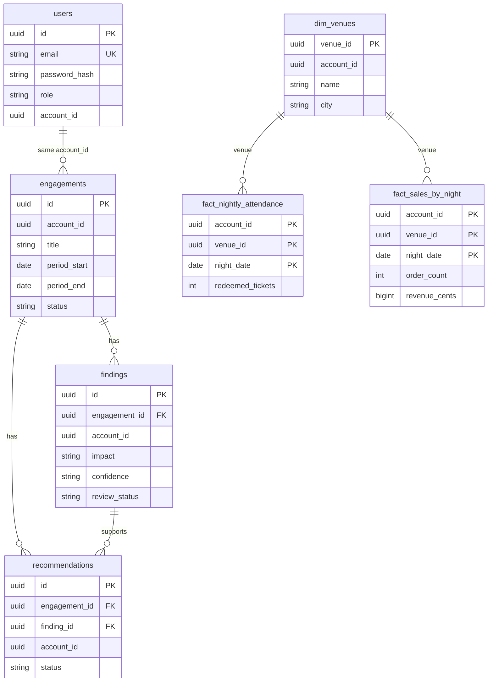

# Modelo de datos — Discover Analytics

## Cómo visualizar la estructura

No hay un plugin MCP de Cursor que introspeccione Postgres y dibuje el ER solo.

| Herramienta | Uso |
|---|---|
| [dbdiagram.io](https://dbdiagram.io) | Importar [`docs/schema.dbml`](schema.dbml) |
| DBeaver / pgAdmin / TablePlus | Conectar a `discover_analytics` y abrir diagrama ER |
| Extensión PostgreSQL (Cursor) | Explorar tablas/columnas |
| Mermaid abajo | Fuente de verdad en el repo |

## Tenant

`account_id` (UUID) es el tenant. En Fase A es un UUID seed fijo (`a1111111-1111-4111-8111-111111111111`). En Fase B se alinea con `accounts.id` / `venues.account_id` de Discover. **Toda** query de negocio filtra por `account_id` del JWT.

## Capas

| Capa | Tablas / objetos | Quién escribe | Qué es |
|---|---|---|---|
| Auth | `analytics.users` | App | Login propio (no customers Pary) |
| Consultoría | `engagements`, `findings`, `recommendations` | App | Metadatos del estudio |
| Hechos seed | `dim_venues`, `fact_nightly_attendance`, `fact_sales_by_night` | Seed / migración | Métricas sin Discover |
| Derivado Discover | `v_nightly_attendance`, `v_sales_by_night` | Solo lectura | Fase B sobre `public` |

`DATA_SOURCE=seed` → repos leen facts. `DATA_SOURCE=discover` → repos leen vistas.

## ER Fase A (`discover_analytics`)

## FKs

- `findings.engagement_id` → `engagements.id`
- `recommendations.engagement_id` → `engagements.id`
- `recommendations.finding_id` → `findings.id` (nullable)
- `fact_*.venue_id` → `dim_venues.venue_id`

No hay FK a Discover en Fase A.

## Seed fijo

| Entidad | UUID |
|---|---|
| account | `a1111111-1111-4111-8111-111111111111` |
| venue A | `b2222222-2222-4222-8222-222222222201` |
| venue B | `b2222222-2222-4222-8222-222222222202` |

Hechos: 14 noches (2026-08-01 … 2026-08-14) × 2 venues.

## Fase B (derivado Discover)

Ver [phase-b-discover.md](phase-b-discover.md) y el [diccionario de métricas](metrics-dictionary.md). Las vistas viven en `sql/views/` y se aplican sobre la Postgres de Discover; la app no duplica `orders`/`tickets`.

| Vista | Grano | Para qué |
|---|---|---|
| `v_nightly_attendance` | venue + noche | Check-ins |
| `v_sales_by_night` | venue + noche | Órdenes pagadas (puente) |
| `v_ticket_sales_by_night` | venue + noche | Boletos e ingreso (`price_paid_cop`) |
| `v_event_metrics` | evento | Ingreso, ocupación, sell-through |
| `v_sellthrough_by_tier` | tier | Etapas de precio; `COUNT` no `sold_quantity` |
| `v_sales_velocity` | evento + ventana | Ritmo pre-evento |
| `v_purchase_hours` | account + hora | Horas pico |
| `v_activity_by_weekday` | account + ISODOW | Mix semanal |
| `v_buyer_mix_by_event` | evento | Nuevos vs recurrentes, n≥10 |
| `v_buyer_mix_by_month` | mes | Igual, n≥10 |
| `v_venues_normalized` | venue | Ciudad y tipo de local limpios + aforo |
| `v_market_by_city` | ciudad | Mercado anónimo; ≥5 locales / ≥3 tenants / ≥20 boletos |
| `v_market_by_venue_type` | tipo de local | Igual, fail-closed |
| `v_market_by_weekday` | ISODOW | Igual, fail-closed |
| `v_market_by_price_band` | banda de precio | Igual, fail-closed |

Las vistas de tenant son solo lectura, con `account_id`, sin PII. Las de mercado **no exponen** `account_id` ni `venue_id`.

Un colectivo/organizador no lee esas vistas a grano venue: el repositorio exige `event_id IN (event_ids)` y borra `venue_id` / aforo / ocupación de las filas de evento.
